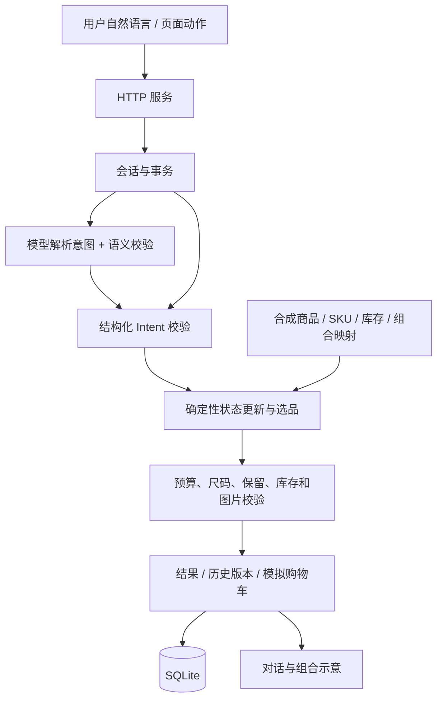

# 架构

- `model.py`：通过选定服务商的 Chat Completions 接口理解意图，配合独立语义检查。配置错误或模型失败会返回错误，不伪造成功回复。
- `core.py`：校验结构化意图、维护约束、挑选已登记组合、生成搭配版本。预算使用整数分；硬约束由代码执行。
- `catalog.py` / `consultation.py`：商品查询和具体单品问答，读取目录事实，不由模型编造价格或材质。
- `dialogue.py`：近期话题、澄清、范围和改口衔接。
- `cart.py`：单件或整套模拟加购。咨询购买能力不会执行加购；对象不明时澄清。
- `service.py` / `storage.py`：会话、幂等、版本冲突、历史、SQLite 事务和过期清理。
- `runtime.py` / `server.py`：来源检查、匿名身份、限额、模型并发限制、静态资源白名单。
- `web/`：原生页面和 JavaScript，不直接调用模型 API。

模型请求会包含当前用户输入以及理解本轮任务所需的会话、历史和商品上下文。运行者应告知体验用户所选模型服务商及数据处理方式。

当前方案适合单进程演示，使用模拟库存和有限组合图。没有真实支付、订单履约、商品后台或实时商家库存连接。
